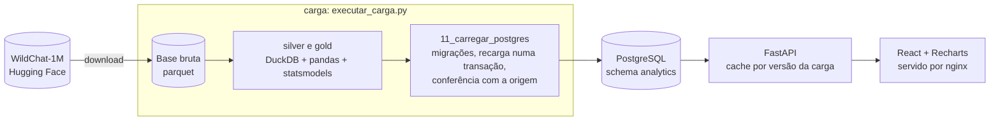

# Retenção de um assistente de inteligência artificial: o que faz quem experimentou voltar em até 7 dias

Desafio Técnico Acaso, vaga Data Analyst Pleno.

Autor: Heitor Beserra da Costa. Novembro de 2026.

Base: WildChat-1M, conversas com `country = 'Brazil'`. Todo número deste documento sai de um relatório em `relatorios/`, gerado por um script em `scripts/`, e a fonte vem indicada em cada seção. Quando um número é uma conta feita sobre outros, a conta aparece junto. As decisões estão registradas em dois tipos de documento: BDR (Business Decision Record, registro de decisão de negócio), em `docs/bdr/`, e ADR (Architecture Decision Record, registro de decisão técnica), em `docs/adr/`. Cada um traz o contexto, as opções consideradas e a escolha.

**Como ler os números.** Valores entre colchetes são o intervalo de confiança de 95%, na mesma unidade do número que vem antes: depois de uma taxa, em porcentagem, como 24,1% [22,5%; 25,8%]; depois de uma diferença entre taxas, em pontos percentuais, como −17,5 pontos percentuais [−21,7; −9,6].

## Resumo

- De 2.482 pessoas que experimentaram o assistente e têm 7 dias de base pela frente, 598 voltaram em até 7 dias: **24,1%, com intervalo de confiança de 95% entre 22,5% e 25,8%**.
- **Três achados para o cliente:**
  1. Quem recebe uma recusa por limitação do produto quase não volta: −17,5 pontos percentuais.
  2. Quem chega sem pedido (só "oi", "teste" ou mensagem vazia) volta menos: −8,5 pontos percentuais.
  3. Usar o GPT-4 não aumenta o retorno.
- O maior efeito medido ficou fora dos achados. Quem envia 5 ou mais mensagens ao assistente na primeira conversa volta mais (+17,0 pontos percentuais). Só que conversar mais é, em boa parte, sinal de que a pessoa já gostou do assistente, e não algo que o produto consiga provocar diretamente. Por isso esse resultado não aponta o que mudar.
- O dashboard sobe com `docker compose up` e tem duas telas: Retenção e O que faz voltar. Ele lê só a base analítica em PostgreSQL e nunca mostra texto de conversa, IP, user-agent ou identificador de usuário.

---

## 1. Definições e quanto o resultado muda com elas (3.1)

| Conceito | Definição adotada | Registro |
|---|---|---|
| Usuário | hashed_ip + sistema operacional + navegador, sem a versão do navegador | BDR-001 |
| Primeira experiência | a primeira conversa do usuário | BDR-002 |
| Sessão | termina depois de 30 minutos sem uso (padrão do Google Analytics) | BDR-003 |
| Retorno | uma 2ª sessão iniciada em até 7 dias depois do início da 1ª conversa | BDR-003 |
| Elegível | 1ª conversa pelo menos 7 dias antes do fim dos dados (janela observada inteira) | BDR-003 |
| Fuso | America/Sao_Paulo para dia, semana e período do dia | premissa |
| Período | toda a base do Brasil: 09/04/2023 a 29/04/2024 | premissa |

**Por que 51 usuários ficam fora da conta.** A base tem 2.533 usuários, mas a taxa é calculada sobre 2.482. Os outros 51 (2.533 − 2.482) fizeram a primeira conversa nos últimos 7 dias da base: os dados terminam em 29/04/2024, às 23h33 (horário universal), e quem chegou depois de 22/04/2024 nesse mesmo horário não tem os 7 dias seguintes registrados. Para essas pessoas não dá para saber se voltaram. Se entrassem na conta, apareceriam como "não voltou" e puxariam a taxa para baixo sem motivo real. Por isso ficam de fora da taxa e dos efeitos, mas continuam na base. O dashboard segue a mesma regra: só conta como novo quem já tem os 7 dias observados.

**Por que não só o IP.** Um mesmo IP pode ser usado por várias pessoas, e um IP chega a ter 35 user-agents. Já o user-agent completo muda sempre que o navegador se atualiza, o que faria uma mesma pessoa virar várias. Sistema + navegador separa aparelhos diferentes atrás do mesmo IP sem quebrar a pessoa a cada atualização.

**Quanto o resultado muda** (fonte: `03_horarios_e_sessao.txt`, `06_desfecho_retorno.txt`):

| Variação | Retorno em 7 dias |
|---|---|
| Regra principal (sessão de 30 minutos) | 24,1% [22,5%; 25,8%] |
| Sessão de 1, 2, 6, 12 e 24 horas | 21,8%, 20,2%, 17,0%, 15,3% e 11,3% |
| "Voltou em outro dia do calendário" (Brasília) | 17,2% [15,7%; 18,7%] |
| Usuário = só IP (2.337 elegíveis) | 24,1% [22,4%; 25,9%] |
| Usuário = IP + user-agent completo (2.832 elegíveis) | 26,1% [24,5%; 27,8%] |
| Excluir IPs com 5 ou mais user-agents | 24,3%, contra 25,4% sem o corte. Nesta comparação, do script 02, cada conversa é datada só pelo horário da última resposta; por isso a taxa sem corte é 25,4%, e não 24,1% |

**O que isso significa.** O nível da taxa depende muito da regra de sessão: vai de 24% a 11%. Por isso o número absoluto só vale com a regra ao lado. Os efeitos, ao contrário, mantêm a direção nas regras de 1 hora, 24 horas e outro dia em quase todos os fatores (seção 5), então as conclusões não dependem da regra escolhida. A definição de usuário muda pouco a taxa, mas a chave com user-agent completo cria 495 "usuários novos" que, na verdade, são IPs já vistos (seção 12).

Entre quem voltou, o tempo até a 2ª sessão tem mediana de 11,1 horas. Um quarto volta em até 2,3 horas.

## 2. Variáveis da primeira experiência (3.1)

Fonte: `04_campos_primeira_conversa.txt`, `07_efeitos.txt`. Faixas de tamanho pelos quartis da base.

| Variável | Como foi derivada | Conferência |
|---|---|---|
| Modelo | coluna `model`, agrupada em GPT-3.5 e GPT-4 | — |
| Nº de turnos | coluna `turn`: 1, 2, 3-4, 5+ | — |
| Período do dia e fim de semana | horário da 1ª resposta do assistente, em Brasília | as mensagens do usuário não têm horário na base |
| 1ª mensagem | sem pedido (vazia, só saudação ou só teste) / curta (<20 caracteres) / média / longa (>194) / texto ausente | as 72 mensagens vazias foram rotuladas uma a uma (BDR-004) |
| Tamanho da 1ª resposta | curta (<137 caracteres) / média / longa (>2.086) | resposta curta não é sinal de falha (BDR-004) |
| Recusa | padrões de texto marcam candidatas; leitura classifica em atendido / parcial / não atendido e o motivo | conferência de 30 recusas sorteadas: 30 de 30 de acordo (intervalo de confiança de 95%: 88,6% a 100%; conferência não cega) (BDR-005) |
| Idioma | coluna `language`: Português, Inglês, outro rótulo | o grupo "outro rótulo" coincidiu com a leitura em só 9 de 100 |
| Código | marcador de bloco de código na pergunta ou na resposta | 99 de 100 técnicas na leitura |
| Tema | dicionário de palavras-chave, 12 temas | 67% de acerto numa amostra nova de 97 (intervalo de confiança de 95%: 57,2% a 75,6%), abaixo do mínimo de 70% fixado antes. Tema fica só como descrição, fora do modelo de efeitos |

**Uso de inteligência artificial na classificação.** Os rótulos de recusa, mensagem vazia, idioma, código e tema foram lidos pelo Claude durante a análise. Só os de recusa, que sustentam um dos achados, passaram por conferência humana (a amostra de 30 acima). Os demais foram aceitos sem conferência. O agrupamento automático de temas (por frequência de palavras, com o método k-means) foi testado em duas versões e descartado pelas regras fixadas antes (`08_temas_escolha_k.txt`): os grupos se formavam por idioma e cumprimento, não por assunto. Nenhum modelo de linguagem roda na carga nem no dashboard. Os rótulos ficam em `docs/rotulos/` (só ids e rótulos, sem texto).

## 3. Qualidade dos dados e tratamento (3.1)

| Problema | Medida | Tratamento |
|---|---|---|
| Não existe id de usuário | 2.385 IPs; 2.533 usuários pela BDR-001 | chave IP + sistema + navegador, com sensibilidade (seção 1) |
| Mensagens do usuário sem horário | 0 de 26.579 têm horário; as do assistente, 26.579 de 26.579 | início da conversa = 1ª resposta do assistente |
| `timestamp` é o último turno | igual ao último horário em 100% das conversas; 99% das conversas duram até 1.103 minutos (cerca de 18 horas) | sessão usa início e fim de cada conversa |
| `conversation_hash` repetido | 93 conversas em hashes repetidos | chave = `turn_identifier` do 1º item (11.621 distintos) |
| IP muito concentrado | um IP tem 1.557 conversas (13,4% da base), 35 user-agents, 130 dias | mantido; corte de IPs com 5+ user-agents muda a taxa em 1,1 ponto percentual |
| IP muda dentro da conversa | 175 conversas | sem tratamento; o usuário é definido pela 1ª conversa |
| Rótulo de idioma pouco confiável | "outro rótulo" correto em 9 de 100; "Nolang" = mensagem vazia em 42 de 42 | efeito bruto de −8,9 pontos percentuais vira −0,1 ponto percentual ajustado: era mensagem curta ou vazia, não idioma |
| 1ª mensagem vazia | 72 usuários com a primeira mensagem vazia na base. Pela leitura das respostas: em 21 a mensagem veio vazia de fato (a resposta diz isso); em 19 não dá para saber (a resposta é só um cumprimento ou pede contexto); em 32 houve um pedido, porque a resposta explica um tema ou recusa algo específico, mas o texto do pedido não está na base | os 21 e os 19 entram como "sem pedido"; os 32 são falha de registro e ganham um nível próprio, "texto ausente", no modelo (BDR-004) |
| Mesmo prompt em vários usuários | um prompt de persona em 20 usuários; um de Midjourney em 10 | mantidos; registrado como possível uso automatizado |
| 5 dias sem nenhuma conversa | 13 e 14/10/2023; 17, 18 e 19/01/2024 | 51 usuários elegíveis com a janela de 7 dias atingida (por coincidência, o mesmo número dos não elegíveis da seção 1, mas são outras pessoas); retorno sem eles: 24,1% [22,4%; 25,8%], igual. Mantidos, porque excluir não muda o resultado; o dashboard marca os dias (`13_sensibilidade_dias_sem_coleta.txt`) |
| Queda brusca de volume | de 34 conversas em 18/07/2023 para 8, 8 e 3 de 20 a 22/07 | ver semana atípica (seção 7) |

## 4. Análise exploratória (3.1)

Fonte: `perfil_brasil.txt`, `04_campos_primeira_conversa.txt`, `10b_dias_sem_dados.txt`, `08b_temas_dicionario.txt`.

- **Tempo.** O pico é em maio de 2023 (2.307 conversas). O volume cai até um vale em 2024 (527 em fevereiro) e volta a subir em março de 2024 (1.011). A mediana é de 24 conversas por dia.
- **Modelo.** 55,2% dos usuários começaram no GPT-3.5 e 44,8% no GPT-4 (de 1.397 e 1.136 em 2.533). O modelo muda com o tempo: no 3º trimestre de 2023 ninguém chegou pelo GPT-4, e em 2024 mais de 90% chegaram por ele. Por isso o modelo se confunde com a época (seção 6).
- **Idioma.** 67,2% Português, 21,0% Inglês, 11,9% outro rótulo.
- **Tamanho.** 46,7% das primeiras conversas têm 1 turno, e 12,8% têm 5 ou mais. A pergunta mediana tem 60 caracteres e a resposta, 942.
- **Tema.** O tema mais comum é perguntas e explicações (25,8%), seguido de programação e planilhas (9,8%) e redação (8,5%). 15,1% caem em "outros". Esses números são só descritivos, porque o acerto da classificação é de 67%.
- **Concentração.** 1.424 dos 2.385 IPs têm uma única conversa. Um único IP tem 13,4% das conversas.
- **Anomalias:** os 5 dias sem coleta e a queda de volume e de retorno de 17/07 a 13/08/2023.

## 5. Efeitos no retorno em 7 dias (3.2)

**Método.** Cada efeito aparece de duas formas.

- **Bruto:** a taxa de retorno do grupo menos a taxa da referência. Por exemplo, quem recebeu recusa voltou 12,7% e quem não recebeu voltou 24,7%, uma diferença de −12,0 pontos percentuais. O intervalo de confiança dessa diferença é calculado pelo método de Newcombe (Newcombe, 1998, *Statistics in Medicine* 17: 873-890). O método monta primeiro um intervalo para cada uma das duas taxas, pelo método de Wilson, e depois combina os dois. A fórmula mais comum, ensinada nos cursos básicos, erra quando a taxa está perto de zero ou o grupo é pequeno, e esta análise tem casos assim (6 retornos em 83 usuários). Nessa comparação de onze métodos, Newcombe recomendou esta combinação por manter a cobertura perto dos 95% prometidos mesmo nesses casos.
- **Ajustado:** a mesma diferença, mas comparando pessoas parecidas nos outros fatores (modelo, turnos, período, primeira mensagem e os demais) e no trimestre de chegada. Uma regressão logística com todos os fatores juntos estima a chance de voltar de cada pessoa. O efeito é a diferença média entre a chance prevista com o fator e sem ele, mantendo o resto de cada pessoa igual (o chamado efeito marginal médio). O intervalo de confiança vem do método delta, que leva a incerteza dos coeficientes da regressão para essa diferença.

Quando bruto e ajustado ficam parecidos, os outros fatores não explicam o efeito. Quando o ajustado encolhe, parte do efeito bruto vinha de outro fator. Exemplo: o idioma "outro rótulo" tem −8,9 pontos percentuais bruto e −0,1 ponto percentual ajustado, porque essas conversas são, na maioria, mensagens curtas ou vazias.

Base de 2.482 usuários. O pseudo-R² do modelo, de 0,036 numa escala de 0 a 1, mede quanto ele explica do retorno; um valor tão baixo significa que a maior parte do que leva alguém a voltar está fora da base. Fonte: `07_efeitos.txt`.

Ordenado pelo tamanho do efeito ajustado, em pontos percentuais, contra a referência:

| Fator (referência) | Nível | Usuários | Retorno | Bruto, em pontos percentuais [intervalo] | Ajustado, em pontos percentuais [intervalo] |
|---|---|---|---|---|---|
| Turnos (1) | 5+ | 316 | 34,2% | +14,0 [+8,4; +19,8] | **+17,0 [+10,6; +23,4]** |
| Recusa (não) | pedido não atendido como pedido | 126 | 12,7% | −12,0 [−17,1; −4,9] | **−11,7 [−17,9; −5,6]** |
| 1ª mensagem (pedido médio) | texto ausente | 32 | 12,5% | −14,2 [−22,2; +1,5] | −11,0 [−23,3; +1,3] |
| Turnos (1) | 3-4 | 424 | 27,4% | +7,1 [+2,4; +12,1] | **+9,1 [+3,6; +14,5]** |
| 1ª mensagem (pedido médio) | sem pedido | 428 | 15,4% | −11,3 [−15,3; −6,9] | **−8,5 [−14,5; −2,4]** |
| Período (tarde) | manhã | 580 | 29,0% | +6,9 [+2,3; +11,6] | **+6,9 [+2,2; +11,7]** |
| Resposta (média) | curta | 626 | 17,3% | −8,5 [−12,2; −4,5] | **−5,5 [−11,0; −0,0]** |
| 1ª mensagem (pedido médio) | curta | 167 | 19,8% | −7,0 [−12,9; +0,1] | −5,0 [−11,5; +1,4] |
| Turnos (1) | 2 | 585 | 23,9% | +3,7 [−0,4; +8,0] | **+4,7 [+0,1; +9,3]** |
| Período (tarde) | noite | 823 | 23,8% | +1,8 [−2,3; +5,8] | +2,1 [−2,1; +6,4] |
| Resposta (média) | longa | 608 | 27,8% | +2,1 [−2,2; +6,5] | +2,1 [−2,3; +6,5] |
| Idioma (Português) | Inglês | 519 | 26,0% | +1,1 [−3,1; +5,5] | +1,7 [−2,5; +6,0] |
| Código (não) | sim | 124 | 25,0% | +1,0 [−6,1; +9,4] | −1,5 [−8,9; +6,0] |
| Modelo (GPT-3.5) | GPT-4 | 1.086 | 24,3% | +0,4 [−3,0; +3,8] | −1,3 [−6,1; +3,5] |
| Período (tarde) | madrugada | 262 | 20,6% | −1,4 [−6,8; +4,5] | −1,1 [−7,1; +5,0] |
| Fim de semana (não) | sim | 648 | 24,5% | +0,6 [−3,1; +4,5] | +0,9 [−2,9; +4,8] |
| 1ª mensagem (pedido médio) | longa | 616 | 26,6% | −0,1 [−4,3; +4,3] | −0,4 [−4,4; +3,5] |
| Idioma (Português) | outro rótulo | 299 | 16,1% | −8,9 [−13,2; −3,9] | −0,1 [−6,6; +6,4] |

Em negrito, os efeitos cujo intervalo de confiança não inclui o zero. Todos eles mantêm a direção nas regras de retorno de 1 hora, 24 horas e outro dia. A recusa separada em dois níveis aponta na mesma direção: parcial −17,0 pontos percentuais [−25,1; −8,8] (só 3 retornos) e não atendido −9,0 pontos percentuais [−16,9; −1,1].

## 6. Confusão: o que é causa e o que é seleção (3.2)

**GPT-4.** A suspeita é que quem escolhe o GPT-4 já seja diferente. E é: mais inglês, mais computador, mais Linux e Edge, mais uso à noite, menos Android e navegador Samsung. Para medir o desequilíbrio, usei a diferença padronizada: a diferença entre a proporção de cada característica nos dois grupos, dividida pelo desvio padrão das duas. Ela não tem unidade, o que permite comparar características diferentes na mesma régua. A referência usual é tratar como desequilibrada a característica com diferença padronizada de 0,10 ou mais, para cima ou para baixo (Austin, 2009, *Statistics in Medicine* 28: 3083-3107). Antes de qualquer tratamento, 20 características passavam desse limite. Foram três tratamentos:

1. Restringir aos trimestres em que os dois modelos tinham pelo menos 100 usuários (2º e 4º trimestres de 2023, 1.280 usuários). Nos outros trimestres falta comparação, porque só um dos modelos estava em uso.
2. Ponderar pelo inverso da probabilidade de escolher o GPT-4, usando só o que existe antes da escolha: período, fim de semana, trimestre, 1ª mensagem, idioma, sistema e navegador. Cada pessoa recebe um peso: quem usou o GPT-4 mas tinha perfil típico de quem usa o GPT-3.5 conta mais, e vice-versa, até os dois grupos ficarem parecidos. O maior peso foi 6,62, isto é, uma pessoa contou como 6,62 na comparação. Depois do peso, sobram 2 características com diferença padronizada acima de 0,10, e a maior é 0,13.
3. Intervalo de confiança por bootstrap, com 1.000 reamostragens.

Resultado: **−3,5 pontos percentuais [−8,2; +2,1]**, contra −1,1 ponto percentual [−5,9; +3,9] sem peso (`09_gpt4_selecao.txt`). Não há evidência de que o GPT-4 aumente o retorno. Uma vantagem acima de cerca de 2 pontos percentuais é incompatível com estes dados.

**Recusa: efeito do produto ou perfil de quem pede?** O retorno menor depois de uma recusa admite duas explicações:

- **Efeito do produto:** a recusa em si afasta a pessoa.
- **Perfil de quem pede (seleção):** quem recebe recusa já tinha menos tendência a voltar. Por exemplo, alguém que testa pedidos proibidos por curiosidade e não pretendia continuar usando. Nesse caso, a recusa só marcaria esse perfil.

Para separar as duas, as recusas foram divididas pelo motivo. Na **limitação do produto**, o assistente não sabe ou não consegue fazer o que foi pedido. Na **política de conteúdo**, o pedido é proibido. A regra de leitura foi definida antes de ver o resultado:
- se só a recusa por política reduzisse o retorno, a explicação mais provável seria o perfil de quem pede;
- se só a recusa por limitação reduzisse, o produto contribui para a perda.

Resultado (`07b_recusa_motivo.txt`):

- Limitação do produto: 7,2% de retorno (6 de 83), −17,5 pontos percentuais [−21,7; −9,6].
- Política de conteúdo: 22,5% (9 de 40), −2,2 pontos percentuais [−12,5; +12,9].
- Os dois grupos diferem entre si: −15,3 pontos percentuais [−30,8; −2,5] (Newcombe sobre 6 de 83 e 9 de 40).

Só a recusa por limitação reduz o retorno. Quem teve um pedido proibido recusado volta quase na mesma taxa de quem não teve recusa. Então o perfil de quem faz pedidos proibidos não explica a perda: ela está nos pedidos legítimos que o produto não conseguiu atender.

**Turnos.** Conversar mais é em parte consequência de já estar gostando, então o efeito de +17,0 pontos percentuais mede engajamento tanto quanto causa. Fica fora dos achados como alavanca.

**O que a análise prova.** Em grupos parecidos no que é observável, recusa por limitação, chegar sem pedido, resposta curta e período do dia estão associados ao retorno, com o tamanho e a incerteza da tabela. O GPT-4 não aumenta o retorno de forma detectável.

**O que não prova.** O que não foi medido, como a intenção da visita ou a experiência prévia com outros assistentes, pode explicar parte de cada efeito. O pseudo-R² de 0,036 (seção 5) mostra que a maior parte do retorno depende de coisas fora da base. As observações são supostas independentes, mas usuários atrás do mesmo IP podem não ser. A prova de causa viria de um experimento com grupos sorteados (seção 8).

## 7. Uma semana atípica: perfil ou taxa? (3.2)

**Regra fixada antes de olhar a série.** Valem só semanas com pelo menos 40 elegíveis. Cada uma é comparada com as 4 anteriores e escolhida a de maior diferença entre as que têm intervalo de confiança sem o zero. Fonte: `10_semana_atipica.txt`, `10_periodo_exploratorio.txt`.

- Das 30 semanas que entram na regra, 2 têm intervalo de confiança sem o zero. Só por acaso, seriam esperadas cerca de 1,5 (5% de 30 semanas). **A série semanal é compatível com ruído.**
- A semana escolhida foi 14/08/2023, com 34,1% (41 usuários) contra 13,7% nas 4 anteriores. Só que essa semana não difere do resto da base: 34,1% contra 23,9%, +10,2 pontos percentuais [−2,5; +25,6] (Newcombe sobre 14 de 41 e 584 de 2.441, isto é, 598 − 14 e 2.482 − 41). Atípicas eram as semanas anteriores.
- **Período de 17/07 a 07/08/2023 (exploratório, escolhido depois de ver a série):** 13,7% (146 usuários) contra 24,7% no resto, uma diferença de −11,0 pontos percentuais [−16,0; −4,3].
- **Decomposição de Kitagawa** (perfil × taxa, uma característica por vez):
  - A parte do perfil fica entre −0,1 e +0,6 ponto percentual em 1ª mensagem, idioma, sistema e período do dia.
  - A parte da taxa fica entre −11,0 e −11,7 pontos percentuais.
  - No modelo, o perfil dá −2,3 pontos percentuais. Essa parte é mecânica: no período só havia GPT-3.5, e a taxa média do GPT-3.5 entra puxada pela própria queda.
- **Conclusão:** não mudou quem chegou. Mudou a taxa de retorno dentro de todos os perfis: celular 9,8% contra 25,1%, noite 6,8% contra 24,8%, inglês 0 de 17.
- No mesmo período, o volume de conversas caiu de forma brusca a partir de 20/07, mas nenhum dia ficou zerado (`10b_dias_sem_dados.txt`). Os dados não permitem separar instabilidade do serviço de perda parcial de registro. Fica como hipótese a investigar com logs do serviço.

A semana de 20/11/2023, a do incidente da seção 12, tem nesta base 20,6% (68 elegíveis) contra 26,5% nas 4 anteriores: −5,9 pontos percentuais [−16,2; +6,5], sem diferença detectável.

## 8. Três achados e a decisão de cada um (3.2)

Cada achado traz o que foi medido, a decisão que ele sustenta e como confirmar o efeito antes de investir. Mais detalhes em `docs/achados.md`.

Duas contas aparecem em todos os achados:
- **Ganho máximo na taxa geral.** Quanto a taxa de retorno de toda a base subiria se o problema fosse resolvido. Supõe que o efeito medido seja todo causado pelo produto, por isso é um teto, não uma previsão.
- **Tamanho do experimento.** Quantos usuários cada grupo precisa ter num experimento com grupos sorteados (metade recebe a mudança, metade não). A conta supõe 5% de chance de apontar um efeito que não existe e 80% de chance de detectar o efeito, se ele existir.

### Achado 1: quando o assistente não consegue fazer o que foi pedido, a pessoa quase não volta

**O que medimos.**
- 83 usuários (3,3% dos novos) tiveram o primeiro pedido recusado porque o assistente não sabia ou não conseguia fazer o que foi pedido. Só 6 deles voltaram: 7,2%, contra 24,7% de quem não teve recusa. A diferença é de −17,5 pontos percentuais [−21,7; −9,6] e continua igual comparando pessoas parecidas nos outros fatores.
- Quem teve um pedido proibido recusado volta quase na mesma taxa de quem não teve recusa: 22,5%. A perda está nos pedidos legítimos não atendidos, não no perfil de quem faz pedido proibido (seção 6).

**Decisão.** Quando não puder atender, o assistente deve dizer o que consegue fazer e oferecer um caminho alternativo, em vez de só recusar. As recusas por limitação também mostram quais capacidades mais faltam, e isso pode orientar o que o produto desenvolve.

**Como confirmar antes de investir.** Um experimento comparando a recusa atual com a recusa que oferece alternativa. Para detectar uma melhora que feche metade da distância até quem não teve recusa (de 7,2% para cerca de 16%), são necessários 207 usuários com recusa por limitação em cada grupo.

**Ganho máximo na taxa geral.** De 24,1% para 24,7%. É pouco no total, porque o grupo é pequeno, mas para essas pessoas a diferença é grande.

### Achado 2: quem chega sem um pedido volta menos

**O que medimos.**
- 428 usuários (17,2% dos novos) abriram a primeira conversa só com "oi", "teste" ou uma mensagem vazia. Desses, 15,4% voltaram, contra 26,7% de quem chegou com um pedido de tamanho médio.
- Comparando pessoas parecidas nos outros fatores, a diferença é de −8,5 pontos percentuais [−14,5; −2,4], e ela aparece em todas as regras de retorno testadas.

**Decisão.** Criar um primeiro uso guiado. Quando a primeira mensagem for só um cumprimento ou um teste, o assistente responde com exemplos concretos do que sabe fazer, para transformar a visita num primeiro pedido real.

**Como confirmar antes de investir.** Parte da diferença pode ser perfil: quem entra só para ver como funciona talvez voltasse menos de qualquer jeito. Um experimento comparando a resposta atual com a resposta guiada separa as duas coisas. Para detectar uma melhora de 15,4% para 23,9% (o tamanho do efeito medido), são necessários 342 usuários em cada grupo.

**Ganho máximo na taxa geral.** De 24,1% para cerca de 25,6%.

### Achado 3: oferecer o GPT-4 não aumenta o retorno

**O que medimos.**
- Quem usa o GPT-4 é diferente de quem usa o GPT-3.5: mais conversas em inglês, mais uso no computador e à noite.
- Comparando grupos equilibrados nessas características, e só nos trimestres em que os dois modelos eram usados, o GPT-4 teve −3,5 pontos percentuais [−8,2; +2,1] de retorno. O intervalo inclui o zero. Uma vantagem do GPT-4 maior que cerca de 2 pontos percentuais é incompatível com os dados.
- O GPT-4 dá respostas mais longas e mais código, mas recusa na mesma proporção (5,3% contra 6,0%).

**Decisão.** Não usar o acesso ao modelo mais avançado como estratégia para trazer as pessoas de volta. Se o GPT-4 custa mais, usar o modelo mais barato como padrão não deve reduzir o retorno.

**Como confirmar.** Se o modelo padrão mudar, acompanhar no dashboard o retorno de quem chega antes e depois da troca, com a mesma definição de retorno. Uma queda maior que o intervalo de confiança das semanas anteriores indica que a conclusão não vale para o produto do cliente.

## 9. O que os dados não permitem medir, e o que falta (3.1)

- **Identidade real.** Sem login, uma pessoa que troca de rede ou de aparelho vira outra. Faltam um id de conta ou um identificador persistente do aparelho.
- **Satisfação.** Não há avaliação da resposta pelo usuário. Faltam um polegar para cima ou para baixo por resposta e um motivo de abandono.
- **Horário das mensagens do usuário.** Falta registrar o horário de cada mensagem enviada.
- **Intenção e origem.** Faltam o canal de aquisição e o que a pessoa veio fazer. É o principal fator não medido da seção 6.
- **Causa.** Só experimentos com grupos sorteados fecham a questão de causa e seleção.

**Sugestões para o assistente:** as decisões dos achados 1 e 2. Também vale revisar respostas curtas na primeira conversa (−5,5 pontos percentuais, no limite da significância).

**Sugestões para o dashboard** (surgiram olhando os dados):
- marcar os dias sem coleta no gráfico (já implementado);
- um indicador semanal de "recusa por limitação" e de "chegou sem pedido";
- um painel de volume diário que alerte quando o volume cai de forma brusca, como em 20/07/2023;
- esconder o intervalo, com aviso, em coortes pequenas (já implementado).

---

## 10. Dashboard (3.3)

### Telas

| Tela | Pergunta | Gráficos | Por que esse tipo |
|---|---|---|---|
| Retenção | Quantos que experimentaram voltaram em até 7 dias, e isso mudou com o tempo? | 3 cartões (novos, voltaram, taxa com intervalo de confiança); linha da taxa por semana ou mês, com a faixa do intervalo; barras de novos num gráfico separado; marcas nos dias sem coleta; opção de ver como tabela | Tempo no eixo x. A faixa mostra que períodos pequenos variam muito. As barras ficam num gráfico separado, sem eixo duplo, para mostrar o tamanho de cada ponto sem misturar escalas. |
| O que faz voltar | O que na primeira conversa muda a chance de voltar, e quanto? | 3 cartões com os achados (calculados pelo backend); pontos com barra do intervalo de confiança, ordenados pelo efeito (forest plot), com a cor dizendo se o intervalo cruza o zero; tabela | Compara tamanho e incerteza de muitos efeitos numa mesma régua com o zero marcado. |

Cada número tem definição e fonte na tela. **O dashboard nunca mostra** texto de conversa, IP (nem o hash), user-agent ou identificador de usuário. Mostra só agregados. Desenho completo em `docs/dashboard_desenho.md`.

### Indicadores

| Indicador | Definição | Fórmula | Denominador | Período de referência |
|---|---|---|---|---|
| Novos | usuários (BDR-001) com 1ª conversa no período e 7 dias observados depois | `count(*)` | — | data da 1ª conversa, Brasília |
| Voltaram | desses, os que começaram uma 2ª sessão em até 7 dias | `count(*) FILTER (WHERE voltou_7d)` | — | idem |
| Taxa de retorno | voltaram / novos, com intervalo de confiança de 95% pelo método de Wilson | `voltaram / novos` | novos elegíveis | idem |
| Efeito de um fator | diferença em pontos percentuais contra a referência, ajustada | efeito marginal médio da logística | elegíveis | base inteira |

```sql
-- api/app/sql/visao_geral.sql
SELECT count(*) AS novos, count(*) FILTER (WHERE voltou_7d) AS voltaram
FROM analytics.usuario_primeira_experiencia
WHERE elegivel AND data_chegada BETWEEN %(inicio)s AND %(fim)s;

-- api/app/sql/coortes.sql (granularidade: 'week' ou 'month', validada no backend)
SELECT date_trunc(%(granularidade)s, data_chegada)::date AS periodo,
       count(*) AS novos, count(*) FILTER (WHERE voltou_7d) AS voltaram
FROM analytics.usuario_primeira_experiencia
WHERE elegivel AND data_chegada BETWEEN %(inicio)s AND %(fim)s
GROUP BY 1 ORDER BY 1;

-- api/app/sql/efeitos.sql (pré-calculados na carga)
SELECT analise, fator, nivel, referencia, usuarios, voltaram, taxa, taxa_referencia,
       bruto, bruto_ic_baixo, bruto_ic_alto, ajustado, ajustado_ic_baixo, ajustado_ic_alto,
       metodo, aviso, fonte
FROM analytics.efeitos ORDER BY analise, abs(ajustado) DESC NULLS LAST;
```

**Base pequena.** Uma coorte com menos de 40 elegíveis aparece como ponto vazado, sem linha e sem faixa de intervalo. Com 40 usuários e taxa perto de 24%, o intervalo de confiança já tem largura de cerca de 26 pontos percentuais. Um efeito com menos de 10 retornos no grupo leva o aviso "poucos casos: intervalo pouco confiável". A visão padrão é mensal, onde quase todo ponto passa de 40.

### Arquitetura



| Peça | Local (`docker compose up`) | AWS (descrito, não implantado) |
|---|---|---|
| Base bruta | `data/` (baixada pela carga se faltar) | S3 |
| Carga | contêiner `carga`, roda e termina | tarefa ECS Fargate agendada pelo EventBridge Scheduler |
| Base analítica | contêiner `postgres:18` | RDS for PostgreSQL (ADR-001) |
| Backend | contêiner `api` (FastAPI + uvicorn) | ECS Fargate atrás de um Application Load Balancer |
| Tela | contêiner `web` (nginx) | S3 + CloudFront, que repassa `/api/*` ao balanceador |
| Segredos e logs | variáveis de ambiente; logs estruturados na saída padrão | Secrets Manager; CloudWatch Logs e alarmes; imagens no ECR |

Não há modelo de linguagem na solução. Se o cliente quiser classificar tema e recusa automaticamente em dados novos, o modelo teria que rodar na AWS (Amazon Bedrock), o que é uma decisão em aberto (seção 13).

**Stack.** Python na carga e no backend, porque é a mesma linguagem da análise: os efeitos saem dos mesmos scripts que geraram este documento. FastAPI dá validação de entrada e documentação dos endpoints sem código extra. React com Recharts, mais um forest plot desenhado direto no código, porque nenhuma biblioteca de gráficos padrão desenha esse tipo com o controle de rótulos que a tela precisa.

**Modelo da base analítica** (`db/migracoes/001_inicial.sql`):

| Tabela | Grão | Conteúdo |
|---|---|---|
| `usuario_primeira_experiencia` | 1 linha por usuário | id (sha256 da chave), data e semana de chegada, fatores da 1ª conversa, elegível, voltou |
| `conversas_dia` | 1 linha por dia | total de conversas (detecta dias sem coleta) |
| `efeitos` | 1 linha por análise, fator e nível | n, taxas, bruto e ajustado com intervalo de confiança, método, aviso, fonte |
| `carga_execucao` | 1 linha por carga | início, fim, versão do código, sha256 da base bruta, linhas, checagens |

**Endpoints:**

| Endpoint | Entrada | Saída |
|---|---|---|
| `GET /api/visao-geral` | inicio, fim | novos, voltaram, taxa, intervalo de confiança, base_pequena, data da carga |
| `GET /api/retencao/coortes` | inicio, fim, granularidade (semana ou mês) | lista de {período, novos, voltaram, taxa, intervalo de confiança, base_pequena} |
| `GET /api/efeitos` | — | lista de {fator, nível, referência, n, taxas, bruto e ajustado com intervalo de confiança, aviso, fonte} |
| `GET /api/qualidade/dias-sem-dados` | inicio, fim | datas sem conversa |
| `GET /api/definicoes`, `/api/periodo`, `/api/saude` | — | textos das definições; período disponível; versão da última carga |

### Outros países

- **Dado.** Uma coluna `pais` em todas as tabelas, e a data de chegada calculada no fuso de cada país. A semana do Brasil começa na segunda em Brasília, e a do México no horário do México.
- **Fuso.** Países com mais de um fuso (Brasil, México, Estados Unidos) precisam de uma decisão: fuso principal do país ou fuso inferido do estado. O WildChat traz a coluna `state`.
- **Interface.** Textos em arquivos de tradução (português, espanhol, inglês), com números e datas no formato de cada local.
- **Comparação.** Mesmas definições para todos os países, e taxa com intervalo de confiança lado a lado. Uma diferença entre países passa pela mesma decomposição perfil × taxa da seção 7, para não confundir mix de usuários com produto. Efeitos estimados por país só onde houver base. O mínimo de 40 por coorte vale por país.

### Desempenho

- **Pré-calculado na carga:** regressões, ponderação do GPT-4 e bootstrap. Nada é estimado na requisição.
- **Calculado na consulta:** agregações simples sobre cerca de 2.500 linhas, com índices em `data_chegada` e `semana_chegada`.
- **Cache:** em memória no backend, por endpoint e parâmetros, com o id da última carga na chave. Uma carga nova muda a chave e invalida tudo. O backend confere a carga a cada 60 segundos, e cada entrada expira em 600 segundos (10 minutos). Na AWS, com mais de uma instância do backend, o cache passaria para o ElastiCache, ou o CloudFront guardaria as respostas pelo mesmo tempo.
- **Medição:** cada requisição grava uma linha de log estruturado (rota, parâmetros, status, duração, versão da carga) e devolve o cabeçalho `Server-Timing`. Na AWS, o percentil 95 do tempo de resposta por rota iria para uma métrica com alarme no CloudWatch.

---

## 11. Monitoramento (4.1)

**O que registrar em cada camada para investigar um número errado depois:**

| Camada | Já registra | Acrescentaria |
|---|---|---|
| Carga | `carga_execucao`: id, início e fim, versão do código, sha256 da base bruta, linhas por tabela, totais conferidos | contagem por dia de chegada, para comparar cargas |
| Base analítica | migrações versionadas (`schema_migrations`); recarga numa transação só | um snapshot dos indicadores por carga, para ver quando um número mudou |
| Backend | log estruturado por requisição com a versão da carga; `Server-Timing` | id de requisição devolvido ao front |
| Tela | data da carga e fonte de cada número | log do erro de tela com o id da requisição |

**Como perceber a divergência antes do cliente.**
- A carga já confere os totais gravados contra a origem e desfaz tudo se não bater (`11_carregar_postgres.py`).
- Acrescentaria uma reconciliação diária: novos e voltaram por semana calculados na base bruta com uma chave independente (só IP) contra o que o backend devolve. Um alarme dispara quando a razão sai da faixa histórica. Foi exatamente essa razão que denunciou o incidente da seção 12.
- Também um alarme de volume diário zerado ou com queda brusca.

**Testes automatizados.**
- Hoje: 12 testes (pytest). Eles conferem o intervalo de Wilson contra valores da análise, a regra de base pequena, a validação de parâmetros, a resposta sem carga e o tempo em toda resposta.
- Acrescentaria testes de definição: uma base de 20 usuários feita à mão, com o retorno esperado de cada um, rodando as consultas reais do Postgres. Por exemplo: uma conversa 29 minutos depois não é retorno; uma 7 dias e 1 minuto depois não é; uma troca de versão do navegador não cria usuário novo.
- Qualquer mudança de definição quebra um teste e exige atualizar o BDR.

**Como uma mudança chega à produção.**
1. Pull request com integração contínua (testes de Python e SQL num Postgres de teste).
2. Migração nova em `db/migracoes`, nunca editando uma antiga.
3. Imagem no ECR.
4. Deploy em homologação, rodando a migração como tarefa antes do backend.
5. Carga completa e reconciliação.
6. Deploy em produção com troca gradual no ECS.

## 12. Investigação do incidente da semana de 20/11/2023 (4.2)

**1. Por onde começar.** Pela comparação dos dois números, antes de abrir o código. O relatório e o dashboard discordam, e a resposta do endpoint mostra onde:

| Semana | Novos (dashboard) | Novos (relatório) | Razão (dashboard ÷ relatório) | Voltaram (dashboard) | Voltaram (relatório) |
|---|---|---|---|---|---|
| 06/11 | 1.210 | 1.150 | 1,05 | 375 | 345 |
| 13/11 | 1.188 | 1.131 | 1,05 | 368 | 351 |
| 20/11 | **2.034** | 1.172 | **1,74** | 366 | 352 |

O número de quem voltou (o numerador da taxa) está estável nas duas fontes. O que dispara é o número de novos do dashboard (o denominador): 862 novos a mais (+74%), enquanto o relatório, que conta por IP, não vê aumento. A taxa caiu porque o denominador inchou, não porque menos gente voltou. Os 862 "novos" a mais quase não voltam, porque o número de retornos não mudou.

**2. Em que camada está a falha.** Na carga, na definição de usuário. O relatório conta por `hashed_ip` e o dashboard por `hashed_ip|user-agent`. A diferença entre as fontes só pode vir dessa chave. Nesta semana, IPs já conhecidos apareceram com user-agents novos, e cada combinação nova virou um usuário novo. O endpoint e a tela só repetem o que a base tem. A base bruta está correta: o user-agent de fato mudou. Consulta para confirmar, sobre a base bruta (sintaxe DuckDB):

```sql
WITH c AS (
    SELECT hashed_ip, header."user-agent" AS ua, "timestamp" AS t
    FROM bruta WHERE country = 'Brazil'
),
chave AS (
    SELECT hashed_ip, ua, min(t) AS primeira_vez, count(*) AS conversas
    FROM c GROUP BY hashed_ip, ua
)
SELECT date_trunc('week', primeira_vez)::date AS semana,
       count(*) AS novos_ip_ua,
       count(*) FILTER (WHERE EXISTS (SELECT 1 FROM c
                                      WHERE c.hashed_ip = chave.hashed_ip
                                        AND c.t < chave.primeira_vez)) AS com_ip_ja_visto,
       count(*) FILTER (WHERE conversas = 1) AS chave_com_uma_conversa
FROM chave
WHERE primeira_vez >= '2023-11-06' AND primeira_vez < '2023-11-27'
GROUP BY 1 ORDER BY 1;
```

Se a hipótese estiver certa, `com_ip_ja_visto` acompanha a diferença entre as duas contagens: cerca de 60 por semana em 06/11 e 13/11 (1.210 − 1.150 e 1.188 − 1.131) e cerca de 860 em 20/11 (2.034 − 1.172). Uma segunda consulta lista os user-agents novos dessa semana ao lado do user-agent anterior do mesmo IP, para ver o que mudou (versão do navegador, formato do cabeçalho, um cliente novo).

Na base real do Brasil, o mecanismo existe (`14_chave_usuario_incidente.txt`). Pela chave IP + user-agent completo, há 2.832 novos contra 2.337 por IP. Dos 2.832, 495 (17,5%) têm IP já visto, e em 350 só o user-agent mudou, com o mesmo sistema e navegador. Aqui, porém, esses falsos novos voltam muito, porque são pessoas que já usavam o assistente, e a taxa sobe em vez de cair (25,7% contra 23,7%). Então, no incidente, os user-agents novos se comportam diferente: aparecem e não voltam com a mesma chave. Isso é compatível com um user-agent que muda entre visitas da mesma pessoa naquela semana. A segunda consulta é a que diz qual foi a mudança, e eu não afirmaria a causa exata antes de rodá-la.

**3. Trecho que causa o problema e correção.** O problema está na chave da carga:

```python
chave = f"{c['hashed_ip']}|{c['header']['user-agent']}"
```

A correção usa sistema e navegador sem versão, a mesma regra da BDR-001 e dos scripts 04 e 06:

```python
def familia(ua: str | None) -> tuple[str, str]:
    """Sistema e navegador sem versão: uma atualização do navegador não cria usuário novo."""
    ua = (ua or "").lower()
    if "android" in ua: so = "Android"
    elif "iphone" in ua or "ipad" in ua: so = "iOS"
    elif "windows" in ua: so = "Windows"
    elif "mac os x" in ua: so = "macOS"
    elif "cros" in ua: so = "ChromeOS"
    elif "linux" in ua: so = "Linux"
    else: so = "Outro"
    if "edg/" in ua: nav = "Edge"
    elif "opr/" in ua: nav = "Opera"
    elif "samsungbrowser" in ua: nav = "Samsung"
    elif "firefox/" in ua: nav = "Firefox"
    elif "chrome/" in ua or "crios/" in ua: nav = "Chrome"
    elif "safari/" in ua: nav = "Safari"
    else: nav = "Outro"
    return so, nav


def chave_usuario(c: dict) -> str:
    so, nav = familia(c["header"].get("user-agent"))
    return sha256(f"{c['hashed_ip']}|{so}|{nav}".encode()).hexdigest()
```

Na carga, `"usuario_id": chave_usuario(c)`. A mesma função, com teste, passa a ser usada pelo relatório semanal. Assim as duas fontes deixam de ter definições diferentes.

Dois pontos a revisar no mesmo código, que não explicam o salto mas distorcem o número:
- O endpoint usa `min(ultimo_turno)` como primeira vez. Deveria usar o primeiro turno.
- Com `ON CONFLICT DO NOTHING`, se uma conversa continuar num dia seguinte e voltar na carga desse dia, o horário novo é descartado e esse retorno se perde.

**4. Além do código.**
- Recalcular o `usuario_id` de todo o histórico, não só dali para frente. Isso é uma recarga completa, porque o hash não pode ser refeito a partir do id antigo.
- Marcar no dashboard as semanas corrigidas.
- Avisar quem usou o número.

Para não voltar:
- uma única definição de usuário, versionada e testada, usada pelo dashboard e pelo relatório;
- um teste em que a troca de versão do navegador não cria usuário novo;
- a reconciliação diária com alarme da seção 11;
- um BDR para qualquer mudança de definição.

**5. O que dizer à gerente de produto.**
- **Durante:** "O número de 18% está em revisão. Na mesma semana, o número de novos do dashboard quase dobrou, e o relatório, que conta de outro jeito, não viu esse aumento. Isso indica um problema de contagem, não uma queda real. Até eu confirmar, não use esse número para decisão. Dou uma posição até [horário]."
- **Depois:** "Não houve queda. O retorno da semana de 20/11 ficou em linha com as anteriores, perto de 30% pelo relatório. O dashboard contava como pessoa nova quem só tinha mudado de navegador ou de versão. Corrigimos a regra, recalculamos o histórico, e agora uma checagem diária compara as duas contagens e avisa antes de chegar à tela."

## 13. Riscos e decisões em aberto (4.3)

**Riscos da solução:**
- **Identidade aproximada.** Um IP compartilhado junta pessoas (um IP tem 13,4% das conversas). Uma troca de rede separa a mesma pessoa. Os efeitos se mantêm nas variações testadas, mas a taxa absoluta pode estar errada em alguns pontos.
- **Classificações por leitura.** Recusa foi conferida numa amostra de 30, de forma não cega. Mensagem vazia, idioma, código e tema não foram conferidos por humano, e tema tem 67% de acerto. Com dados novos, não há quem leia: a classificação automática teria que ser construída e validada.
- **Efeitos associativos.** Só experimento com grupos sorteados prova causa. Grupos pequenos (6 retornos na recusa por limitação) têm intervalo de confiança largo.
- **Base de pesquisa, não do cliente.** Padrões de um chatbot público de 2023-2024 podem não valer para o produto do cliente.
- **Dados pessoais.** As conversas podem ter dados pessoais. A base analítica não guarda texto, IP nem user-agent, mas a base bruta guarda e precisa de acesso restrito no S3.
- **Docker.** Na máquina de desenvolvimento, o Docker Desktop não subiu ("Virtual Machine Platform is not enabled"). A solução foi validada com PostgreSQL nativo, o backend e o front locais, rodando os mesmos scripts da carga. [Atualizar após o teste de `docker compose up`.]

**Decisões que levaria ao cliente ou ao time antes de implementar:**
1. A definição de usuário e de retorno (regra de sessão e janela): muda o número em até 13 pontos percentuais.
2. Se dá para ter login ou um id persistente: resolve o maior risco.
3. Coletar avaliação da resposta e o horário das mensagens do usuário.
4. Rodar os dois experimentos com grupos sorteados dos achados 1 e 2, com o tamanho de amostra da seção 8.
5. Classificação automática em produção: usar Bedrock, com o custo e a validação que isso exige, ou manter só variáveis sem leitura de texto.
6. Retenção e acesso aos dados brutos (Lei Geral de Proteção de Dados): quem pode ver a base bruta e por quanto tempo.
7. Política para semanas com coleta incompleta: mostrar com aviso ou esconder.

## 14. Uso de inteligência artificial

Usei o Claude (Anthropic) em todas as etapas:
- **Discovery:** perfil da base, problemas de horário e de chave.
- **Análise:** desenho das regras fixadas antes de rodar, regressão, ponderação, decomposição.
- **Código:** scripts, backend, front e carga.
- **Texto:** este documento, ADRs e BDRs.
- **Leitura e rotulagem** de amostras de conversas.

O que conferi:
- Rodei todos os scripts na minha máquina e cada número veio da saída deles. O ambiente do Claude não tinha as bibliotecas da análise.
- Conferi 30 recusas sorteadas.
- Revisei os arquivos antes de cada commit.
- Pedi que regras de decisão fossem fixadas antes de ver o resultado.

O que foi corrigido ou descartado:
- O agrupamento automático de temas falhou nos critérios e foi trocado pelo dicionário.
- A primeira versão do dicionário (55% de acerto) foi corrigida, e mesmo assim tema ficou fora do modelo.
- A primeira versão da ponderação do GPT-4 violava a sobreposição e foi refeita só nos trimestres com os dois modelos.
- A primeira escolha de semana atípica se revelou uma volta ao normal.

Dediquei cerca de 15 horas ao desafio, em 3 dias.
