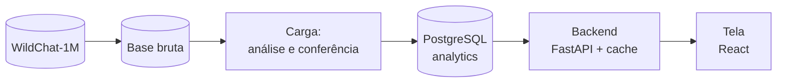

# Retenção de um assistente de inteligência artificial: o que faz quem experimentou voltar em até 7 dias

Desafio Técnico Acaso, vaga Data Analyst Pleno.

Autor: Heitor Beserra da Costa. Novembro de 2026.

Base: WildChat-1M, conversas com `country = 'Brazil'`. Cada número sai de um relatório em `relatorios/`, gerado por um script em `scripts/`; quando é conta sobre outros números, a conta aparece junto. As decisões estão registradas como BDR (Business Decision Record, registro de decisão de negócio), em `docs/bdr/`, e ADR (Architecture Decision Record, registro de decisão técnica), em `docs/adr/`, cada um com contexto, opções consideradas e escolha.

**Como ler os números.** Valores entre colchetes são o intervalo de confiança de 95%, na unidade do número que vem antes: depois de uma taxa, em porcentagem, como 24,1% [22,5%; 25,8%]; depois de uma diferença entre taxas, em pontos percentuais, como −17,5 pontos percentuais [−21,7; −9,6].

## Resumo

- De 2.482 pessoas que experimentaram o assistente e têm 7 dias de base pela frente, 598 voltaram em até 7 dias: **24,1% [22,5%; 25,8%]**.
- **Três achados para o cliente:**
  1. Quem tem o pedido recusado porque o assistente não consegue atendê-lo quase não volta: −17,5 pontos percentuais.
  2. Quem chega sem pedido (só "oi", "teste" ou mensagem vazia) volta menos: −8,5 pontos percentuais.
  3. Usar o GPT-4 não aumenta o retorno.
- O maior efeito medido ficou fora dos achados: quem envia 5 ou mais mensagens na primeira conversa volta mais (+17,0 pontos percentuais). Conversar mais é, em boa parte, sinal de que a pessoa já gostou do assistente, e não algo que o produto consiga provocar diretamente.
- O dashboard sobe com `docker compose up --build`, tem duas telas (Retenção e O que faz voltar), lê só a base analítica em PostgreSQL e nunca mostra texto de conversa, IP, user-agent ou identificador de usuário.

---

## 1. Definições e quanto o resultado muda com elas (3.1)

| Conceito | Definição adotada | Registro |
|---|---|---|
| Usuário | hashed_ip + sistema operacional + navegador, sem a versão do navegador | BDR-001 |
| Primeira experiência | a primeira conversa do usuário | BDR-002 |
| Sessão | termina depois de 30 minutos sem uso (padrão do Google Analytics) | BDR-003 |
| Retorno | uma 2ª sessão iniciada em até 7 dias depois do início da 1ª conversa | BDR-003 |
| Elegível | 1ª conversa pelo menos 7 dias antes do fim dos dados | BDR-003 |
| Fuso e período | America/Sao_Paulo; toda a base do Brasil, de 09/04/2023 a 29/04/2024 | premissa |

**Por que 51 usuários ficam fora da conta.** A base tem 2.533 usuários, mas a taxa usa 2.482. Os outros 51 chegaram nos últimos 7 dias da base (depois de 22/04/2024): não dá para saber se voltaram, e contá-los como "não voltou" puxaria a taxa para baixo sem motivo. Ficam fora da taxa e dos efeitos, e o dashboard segue a mesma regra.

**Por que não só o IP.** Um IP pode ser de várias pessoas (um deles tem 35 user-agents), e o user-agent completo muda a cada atualização do navegador, o que dividiria a mesma pessoa. Sistema + navegador separa aparelhos atrás do mesmo IP sem esse problema.

**Quanto o resultado muda** (`03_horarios_e_sessao.txt`, `06_desfecho_retorno.txt`):

| Variação | Retorno em 7 dias |
|---|---|
| Regra principal (sessão de 30 minutos) | 24,1% [22,5%; 25,8%] |
| Sessão de 1, 2, 6, 12 e 24 horas | 21,8%, 20,2%, 17,0%, 15,3% e 11,3% |
| "Voltou em outro dia do calendário" | 17,2% [15,7%; 18,7%] |
| Usuário = só IP / IP + user-agent completo | 24,1% [22,4%; 25,9%] / 26,1% [24,5%; 27,8%] |

A regra de sessão muda o nível da taxa (de 24% a 11%), então o número só vale com a regra ao lado. Os efeitos, porém, mantêm a direção nas regras de 1 hora, 24 horas e outro dia (seção 5): as conclusões não dependem da regra. Entre quem voltou, a mediana até a 2ª sessão é de 11,1 horas.

## 2. Variáveis da primeira experiência (3.1)

Fonte: `04_campos_primeira_conversa.txt`, `07_efeitos.txt`. Faixas de tamanho pelos quartis da base.

| Variável | Como foi derivada | Conferência |
|---|---|---|
| Modelo | coluna `model`: GPT-3.5 ou GPT-4 | — |
| Nº de turnos | coluna `turn` (cada turno = uma mensagem e uma resposta): 1, 2, 3-4, 5+ | — |
| Período do dia, fim de semana | horário da 1ª resposta do assistente, em Brasília | mensagens do usuário não têm horário |
| 1ª mensagem | sem pedido (vazia, saudação ou teste) / curta (<20 caracteres) / média / longa (>194) / texto ausente | 72 mensagens vazias lidas uma a uma (BDR-004) |
| Tamanho da 1ª resposta | curta (<137 caracteres) / média / longa (>2.086) | — |
| Recusa | padrões de texto marcam candidatas; leitura classifica em atendido, parcial ou não atendido, e o motivo | 30 recusas sorteadas conferidas pelo autor: 30 de 30 de acordo [88,6%; 100%], conferência não cega (BDR-005) |
| Idioma | coluna `language`: Português, Inglês, outro rótulo | "outro rótulo" correto em só 9 de 100 |
| Código | marcador de bloco de código na pergunta ou na resposta | 99 de 100 corretos |
| Tema | dicionário de palavras-chave, 12 temas | 67% de acerto [57,2%; 75,6%], abaixo dos 70% fixados antes: só descritivo, fora do modelo (BDR-006) |

**Uso de inteligência artificial na classificação.** Os rótulos de recusa, mensagem vazia, idioma, código e tema foram lidos pelo Claude. Só os de recusa, que sustentam um achado, passaram por conferência humana. Nenhum modelo de linguagem roda na carga nem no dashboard; os rótulos ficam em `docs/rotulos/`, só com ids.

## 3. Qualidade dos dados e tratamento (3.1)

| Problema | Medida | Tratamento |
|---|---|---|
| Não há id de usuário | 2.385 IPs; 2.533 usuários pela BDR-001 | chave IP + sistema + navegador, com sensibilidade (seção 1) |
| Mensagens do usuário sem horário | 0 de 26.579 têm horário; as do assistente, todas | início da conversa = 1ª resposta do assistente |
| `timestamp` é o último turno | em 100% das conversas; 99% duram até 1.103 minutos | sessão usa início e fim de cada conversa |
| `conversation_hash` repetido | 93 conversas | chave = `turn_identifier` do 1º item (11.621 distintos) |
| IP muito concentrado | um IP tem 13,4% das conversas e 35 user-agents | mantido; excluir IPs com 5+ user-agents muda a taxa em 1,1 ponto percentual |
| Rótulo de idioma ruim | "Nolang" = mensagem vazia em 42 de 42 | idioma "outro rótulo": −8,9 pontos percentuais bruto, −0,1 ajustado (era mensagem curta ou vazia) |
| 1ª mensagem vazia | 72 usuários: 21 vazias de fato, 19 indeterminadas, 32 com pedido cujo texto não está na base | os 21 e os 19 = "sem pedido"; os 32 = falha de registro, nível "texto ausente" (BDR-004) |
| Mesmo prompt em vários usuários | um em 20 usuários, outro em 10 | mantidos; possível uso automatizado |
| 5 dias sem nenhuma conversa | 13 e 14/10/2023; 17 a 19/01/2024 | 51 elegíveis afetados; sem eles, 24,1% [22,4%; 25,8%], igual: mantidos, dias marcados no dashboard (`13_sensibilidade_dias_sem_coleta.txt`) |

## 4. Análise exploratória (3.1)

Fonte: `perfil_brasil.txt`, `04_campos_primeira_conversa.txt`, `08b_temas_dicionario.txt`, `10b_dias_sem_dados.txt`.

- **Tempo.** Pico em maio de 2023 (2.307 conversas), vale em fevereiro de 2024 (527), alta em março de 2024 (1.011). Mediana de 24 conversas por dia.
- **Modelo.** 55,2% dos usuários começaram no GPT-3.5. O modelo muda com o tempo: no 3º trimestre de 2023 ninguém chegou pelo GPT-4; em 2024, mais de 90%. Por isso modelo se confunde com época (seção 6).
- **Idioma.** 67,2% Português, 21,0% Inglês, 11,9% outro rótulo.
- **Tamanho.** 46,7% das primeiras conversas têm 1 turno; 12,8% têm 5 ou mais.
- **Tema** (descritivo). Perguntas e explicações 25,8%, programação e planilhas 9,8%, redação 8,5%, outros 15,1%.
- **Concentração.** 1.424 dos 2.385 IPs têm uma única conversa.
- **Anomalias.** Os 5 dias sem coleta e a queda de volume e de retorno de 17/07 a 13/08/2023 (seção 7).

## 5. Efeitos no retorno em 7 dias (3.2)

**Método.** Cada efeito aparece de duas formas:

- **Bruto:** taxa do grupo menos taxa da referência (ex.: recusa 12,7% contra 24,7%, −12,0 pontos percentuais). O intervalo é o de Newcombe (1998, *Statistics in Medicine* 17: 873-890): calcula um intervalo de Wilson para cada taxa e combina os dois. A fórmula comum erra com taxas perto de zero e grupos pequenos, como 6 retornos em 83 usuários; a de Newcombe mantém a cobertura perto dos 95%.
- **Ajustado:** a mesma diferença entre pessoas parecidas nos outros fatores e no trimestre de chegada. Uma regressão logística com todos os fatores estima a chance de voltar de cada pessoa; o efeito é a diferença média entre a chance prevista com o fator e sem ele (efeito marginal médio). O intervalo vem do método delta.

Se o ajustado encolhe, parte do efeito bruto vinha de outro fator. O pseudo-R² do modelo, de 0,036 numa escala de 0 a 1, mostra que a maior parte do que leva alguém a voltar está fora da base. Base de 2.482 usuários (`07_efeitos.txt`).

Diferenças em pontos percentuais contra a referência, ordenadas pelo efeito ajustado:

| Fator (referência) | Nível | Usuários | Retorno | Bruto | Ajustado |
|---|---|---|---|---|---|
| Turnos (1) | 5+ | 316 | 34,2% | +14,0 [+8,4; +19,8] | **+17,0 [+10,6; +23,4]** |
| Recusa (não) | pedido não atendido | 126 | 12,7% | −12,0 [−17,1; −4,9] | **−11,7 [−17,9; −5,6]** |
| 1ª mensagem (média) | texto ausente | 32 | 12,5% | −14,2 [−22,2; +1,5] | −11,0 [−23,3; +1,3] |
| Turnos (1) | 3-4 | 424 | 27,4% | +7,1 [+2,4; +12,1] | **+9,1 [+3,6; +14,5]** |
| 1ª mensagem (média) | sem pedido | 428 | 15,4% | −11,3 [−15,3; −6,9] | **−8,5 [−14,5; −2,4]** |
| Período (tarde) | manhã | 580 | 29,0% | +6,9 [+2,3; +11,6] | **+6,9 [+2,2; +11,7]** |
| Resposta (média) | curta | 626 | 17,3% | −8,5 [−12,2; −4,5] | **−5,5 [−11,0; −0,0]** |
| 1ª mensagem (média) | curta | 167 | 19,8% | −7,0 [−12,9; +0,1] | −5,0 [−11,5; +1,4] |
| Turnos (1) | 2 | 585 | 23,9% | +3,7 [−0,4; +8,0] | **+4,7 [+0,1; +9,3]** |
| Período (tarde) | noite | 823 | 23,8% | +1,8 [−2,3; +5,8] | +2,1 [−2,1; +6,4] |
| Resposta (média) | longa | 608 | 27,8% | +2,1 [−2,2; +6,5] | +2,1 [−2,3; +6,5] |
| Idioma (Português) | Inglês | 519 | 26,0% | +1,1 [−3,1; +5,5] | +1,7 [−2,5; +6,0] |
| Código (não) | sim | 124 | 25,0% | +1,0 [−6,1; +9,4] | −1,5 [−8,9; +6,0] |
| Modelo (GPT-3.5) | GPT-4 | 1.086 | 24,3% | +0,4 [−3,0; +3,8] | −1,3 [−6,1; +3,5] |
| Período (tarde) | madrugada | 262 | 20,6% | −1,4 [−6,8; +4,5] | −1,1 [−7,1; +5,0] |
| Fim de semana (não) | sim | 648 | 24,5% | +0,6 [−3,1; +4,5] | +0,9 [−2,9; +4,8] |
| 1ª mensagem (média) | longa | 616 | 26,6% | −0,1 [−4,3; +4,3] | −0,4 [−4,4; +3,5] |
| Idioma (Português) | outro rótulo | 299 | 16,1% | −8,9 [−13,2; −3,9] | −0,1 [−6,6; +6,4] |

Em negrito, os efeitos cujo intervalo não inclui o zero; todos mantêm a direção nas regras de 1 hora, 24 horas e outro dia. Separada em dois níveis, a recusa aponta na mesma direção: parcial −17,0 pontos percentuais [−25,1; −8,8] e não atendido −9,0 [−16,9; −1,1].

## 6. Confusão: o que é causa e o que é seleção (3.2)

**GPT-4.** Quem escolhe o GPT-4 é diferente: mais inglês, computador, Linux e Edge, uso à noite; menos Android. O desequilíbrio foi medido pela diferença padronizada (diferença entre as proporções de cada característica, dividida pelo desvio padrão; sem unidade). A referência usual considera desequilibrada a característica com 0,10 ou mais, para cima ou para baixo (Austin, 2009, *Statistics in Medicine* 28: 3083-3107). Eram 20 características. Três tratamentos:

1. Só os trimestres com pelo menos 100 usuários em cada modelo (2º e 4º de 2023; 1.280 usuários). Nos outros, só um modelo estava em uso.
2. Ponderação pelo inverso da probabilidade de escolher o GPT-4, usando só o que existe antes da escolha (período, fim de semana, trimestre, 1ª mensagem, idioma, sistema, navegador). Quem usou o GPT-4 com perfil típico do GPT-3.5 conta mais, e vice-versa; o maior peso foi 6,62 (uma pessoa contou como 6,62). Depois do peso, sobram 2 características acima de 0,10, a maior com 0,13.
3. Intervalo por bootstrap, com 1.000 reamostragens.

Resultado: **−3,5 pontos percentuais [−8,2; +2,1]**, contra −1,1 [−5,9; +3,9] sem peso (`09_gpt4_selecao.txt`). Não há evidência de que o GPT-4 aumente o retorno; uma vantagem acima de cerca de 2 pontos percentuais é incompatível com os dados.

**Recusa: efeito do produto ou perfil de quem pede?** O retorno menor depois de uma recusa admite duas explicações: a recusa em si afasta a pessoa (efeito do produto), ou quem recebe recusa já tinha menos tendência a voltar, como quem testa pedidos proibidos por curiosidade (seleção). Para separar, as recusas foram divididas pelo motivo: **limitação do produto** (o assistente não sabe ou não consegue) e **política de conteúdo** (pedido proibido). Regra fixada antes: se só a recusa por política reduzisse o retorno, a explicação seria o perfil; se só a por limitação, o produto contribui (BDR-007).

- Limitação do produto: 7,2% de retorno (6 de 83), −17,5 pontos percentuais [−21,7; −9,6].
- Política de conteúdo: 22,5% (9 de 40), −2,2 [−12,5; +12,9].
- Entre os dois grupos: −15,3 [−30,8; −2,5] (Newcombe sobre 6 de 83 e 9 de 40).

Só a recusa por limitação reduz o retorno: a perda está nos pedidos legítimos que o produto não conseguiu atender, não no perfil de quem faz pedido proibido.

**Turnos.** Conversar mais é em parte consequência de já estar gostando; o +17,0 mede engajamento tanto quanto causa.

**O que a análise prova e o que não prova.** Em grupos parecidos no que é observável, recusa por limitação, chegar sem pedido, resposta curta e período do dia estão associados ao retorno, com o tamanho e a incerteza da tabela; o GPT-4 não aumenta o retorno de forma detectável. O que não foi medido (intenção da visita, experiência com outros assistentes) pode explicar parte de cada efeito, e usuários atrás do mesmo IP podem não ser independentes. Causa só se prova com experimento com grupos sorteados (seção 8).

## 7. Uma semana atípica: perfil ou taxa? (3.2)

**Regra fixada antes de olhar a série:** semanas com pelo menos 40 elegíveis, comparadas com as 4 anteriores; escolhida a de maior diferença entre as que têm intervalo sem o zero (`10_semana_atipica.txt`, `10_periodo_exploratorio.txt`).

- Só 2 das 30 semanas têm intervalo sem o zero; por acaso, seriam cerca de 1,5 (5% de 30). **A série semanal é compatível com ruído.**
- A escolhida, 14/08/2023 (34,1%, 41 usuários), não difere do resto da base: +10,2 pontos percentuais [−2,5; +25,6] (Newcombe sobre 14 de 41 e 584 de 2.441). Atípicas eram as semanas anteriores.
- **Período de 17/07 a 07/08/2023** (exploratório, escolhido depois de ver a série): 13,7% (146 usuários) contra 24,7% no resto, −11,0 [−16,0; −4,3].
- **Decomposição de Kitagawa** (perfil × taxa, uma característica por vez): a parte do perfil fica entre −0,1 e +0,6 ponto percentual (1ª mensagem, idioma, sistema, período do dia); a da taxa, entre −11,0 e −11,7. No modelo, o perfil dá −2,3, efeito mecânico de o período só ter GPT-3.5.
- **Conclusão:** não mudou quem chegou; caiu a taxa dentro de todos os perfis (celular 9,8% contra 25,1%; noite 6,8% contra 24,8%). O volume também caiu de forma brusca a partir de 20/07, sem dia zerado; os dados não separam instabilidade do serviço de perda parcial de registro.

A semana de 20/11/2023, a do incidente da seção 12, tem nesta base 20,6% (68 elegíveis) contra 26,5% nas 4 anteriores: −5,9 [−16,2; +6,5], sem diferença detectável.

## 8. Três achados e a decisão de cada um (3.2)

Duas contas aparecem nos três: o **ganho máximo na taxa geral**, que supõe o efeito todo causado pelo produto (um teto, não uma previsão); e o **tamanho do experimento**, com metade dos usuários recebendo a mudança, 5% de chance de apontar efeito que não existe e 80% de chance de detectar o efeito se ele existir. Detalhes em `docs/achados.md`.

### Achado 1: quando o assistente não consegue fazer o que foi pedido, a pessoa quase não volta

- **O que medimos.** 83 usuários (3,3% dos novos) tiveram o pedido recusado por limitação do produto. Voltaram 7,2%, contra 24,7% sem recusa: −17,5 pontos percentuais [−21,7; −9,6], igual entre pessoas parecidas. Recusa por pedido proibido não reduz o retorno (seção 6).
- **Decisão.** Quando não puder atender, o assistente diz o que consegue fazer e oferece um caminho alternativo, em vez de só recusar. As recusas por limitação mostram as capacidades que mais faltam.
- **Como confirmar.** Experimento com recusa atual contra recusa com alternativa: 207 usuários com recusa por limitação em cada grupo para detectar uma melhora de 7,2% para cerca de 16% (metade da distância).
- **Ganho máximo na taxa geral.** De 24,1% para 24,7%: pouco no total, grande para quem passa por isso.

### Achado 2: quem chega sem um pedido volta menos

- **O que medimos.** 428 usuários (17,2% dos novos) abriram só com "oi", "teste" ou mensagem vazia. Voltaram 15,4%, contra 26,7% de quem chegou com pedido médio; entre pessoas parecidas, −8,5 pontos percentuais [−14,5; −2,4], em todas as regras de retorno.
- **Decisão.** Primeiro uso guiado: quando a 1ª mensagem for só cumprimento ou teste, responder com exemplos concretos do que o assistente faz.
- **Como confirmar.** Parte da diferença pode ser perfil (quem entra só para ver talvez não voltasse). Experimento com resposta atual contra resposta guiada: 342 usuários por grupo para detectar 15,4% → 23,9%.
- **Ganho máximo na taxa geral.** De 24,1% para cerca de 25,6%.

### Achado 3: oferecer o GPT-4 não aumenta o retorno

- **O que medimos.** Em grupos equilibrados, nos trimestres com os dois modelos: −3,5 pontos percentuais [−8,2; +2,1]. O GPT-4 dá respostas mais longas e mais código, mas recusa na mesma proporção (5,3% contra 6,0%).
- **Decisão.** Não usar o modelo mais avançado como estratégia de retenção. Se o GPT-4 custa mais, o modelo mais barato como padrão não deve reduzir o retorno.
- **Como confirmar.** Se o padrão mudar, acompanhar no dashboard o retorno antes e depois da troca; uma queda fora do intervalo das semanas anteriores indica que a conclusão não vale para o produto do cliente.

## 9. O que os dados não permitem medir, e sugestões (3.1)

**Falta:** id de conta ou de aparelho (sem login, quem troca de rede vira outra pessoa); avaliação da resposta pelo usuário e motivo de abandono; horário das mensagens do usuário; canal de aquisição e intenção da visita (o principal fator não medido); experimentos para provar causa.

**Para o assistente:** os achados 1 e 2; revisar respostas curtas na primeira conversa (−5,5 pontos percentuais, no limite).

**Para o dashboard** (ideias que vieram dos dados): marcar dias sem coleta (feito); esconder o intervalo em coortes pequenas (feito); indicadores semanais de "recusa por limitação" e "chegou sem pedido"; alerta de queda brusca de volume diário, como em 20/07/2023.

---

## 10. Dashboard (3.3)

### Telas

| Tela | Pergunta | Gráficos e por quê |
|---|---|---|
| Retenção | Quantos que experimentaram voltaram em até 7 dias, e isso mudou com o tempo? | Cartões (novos, voltaram, taxa com intervalo). Linha da taxa por semana ou mês com faixa do intervalo: mostra que períodos pequenos variam muito. Barras de novos em gráfico separado, sem eixo duplo, para mostrar o tamanho de cada ponto. Marcas nos dias sem coleta. Opção de tabela. |
| O que faz voltar | O que na primeira conversa muda a chance de voltar, e quanto? | Cartões com os 3 achados. Forest plot: um ponto e uma barra de intervalo por efeito, ordenados, com o zero marcado e a cor dizendo se o intervalo cruza o zero; compara tamanho e incerteza na mesma régua. Opção de tabela. |

Cada número tem definição e fonte na tela. **O dashboard nunca mostra** texto de conversa, IP (nem o hash), user-agent ou identificador de usuário; só agregados. Desenho completo em `docs/dashboard_desenho.md`.

### Indicadores

| Indicador | Definição | Denominador | Período de referência |
|---|---|---|---|
| Novos | usuários com 1ª conversa no período e 7 dias observados depois | — | data da 1ª conversa, Brasília |
| Voltaram | desses, os que começaram uma 2ª sessão em até 7 dias | — | idem |
| Taxa de retorno | voltaram / novos, com intervalo de Wilson | novos | idem |
| Efeito de um fator | diferença ajustada contra a referência (seção 5) | elegíveis | base inteira |

```sql
-- api/app/sql/visao_geral.sql (cartões)
SELECT count(*) AS novos, count(*) FILTER (WHERE voltou_7d) AS voltaram
FROM analytics.usuario_primeira_experiencia
WHERE elegivel AND data_chegada BETWEEN %(inicio)s AND %(fim)s;

-- api/app/sql/coortes.sql (série; granularidade 'week' ou 'month', validada no backend)
SELECT date_trunc(%(granularidade)s, data_chegada)::date AS periodo,
       count(*) AS novos, count(*) FILTER (WHERE voltou_7d) AS voltaram
FROM analytics.usuario_primeira_experiencia
WHERE elegivel AND data_chegada BETWEEN %(inicio)s AND %(fim)s
GROUP BY 1 ORDER BY 1;
```

Os efeitos são lidos prontos da tabela `analytics.efeitos` (`api/app/sql/efeitos.sql`).

**Base pequena.** Com 40 usuários e taxa perto de 24%, o intervalo já tem cerca de 26 pontos percentuais de largura. Por isso coorte com menos de 40 elegíveis aparece como ponto vazado, sem linha nem faixa, e efeito com menos de 10 retornos leva o aviso "poucos casos: intervalo pouco confiável". A visão padrão é mensal, em que quase todo ponto passa de 40.

### Arquitetura



A carga roda a análise (DuckDB, pandas e statsmodels), aplica as migrações, grava tudo numa transação e confere os totais com a origem; se algo não bate, desfaz a gravação. A tela usa Recharts e é servida por nginx, que repassa `/api` ao backend.

| Peça | Local (`docker compose`) | AWS (descrito, não implantado; ADR-004) |
|---|---|---|
| Base bruta | pasta `data/` | S3, com acesso restrito |
| Carga | contêiner que roda e termina | tarefa no ECS Fargate agendada pelo EventBridge Scheduler |
| Base analítica | `postgres:18` | RDS for PostgreSQL (ADR-001) |
| Backend | FastAPI | ECS Fargate atrás de um Application Load Balancer |
| Tela | nginx | S3 + CloudFront, que repassa `/api/*` ao balanceador |
| Senhas e logs | variáveis de ambiente; saída padrão | Secrets Manager; CloudWatch |

**Stack (ADR-002).** Python na carga e no backend, a mesma linguagem da análise: os efeitos saem dos mesmos scripts deste documento. React com Recharts na tela, e o forest plot desenhado no código para controlar rótulos e o zero. Não há modelo de linguagem; classificar tema e recusa em dados novos exigiria um na AWS (Bedrock), decisão em aberto.

**Modelo da base analítica** (`db/migracoes/001_inicial.sql`): `usuario_primeira_experiencia` (1 linha por usuário: id em sha256, chegada, fatores da 1ª conversa, elegível, voltou), `conversas_dia` (volume diário, detecta dias sem coleta), `efeitos` (1 linha por fator e nível, com bruto, ajustado, intervalos, método e fonte) e `carga_execucao` (1 linha por carga: versão do código, sha256 da base bruta, contagens e checagens).

#### Endpoints

| Endpoint | Entrada | Saída |
|---|---|---|
| `GET /api/visao-geral` | inicio, fim | novos, voltaram, taxa, intervalo, base pequena, data da carga |
| `GET /api/retencao/coortes` | inicio, fim, granularidade | lista de período, novos, voltaram, taxa, intervalo, base pequena |
| `GET /api/efeitos` | — | lista de fator, nível, referência, n, taxas, bruto e ajustado com intervalo, aviso, fonte |
| `GET /api/qualidade/dias-sem-dados` | inicio, fim | datas sem conversa |
| `GET /api/saude`, `/api/definicoes`, `/api/periodo` | — | versão da carga; textos das definições; período disponível |

### Outros países

- Coluna `pais` em todas as tabelas e data de chegada no fuso de cada país; países com mais de um fuso (Brasil, México, Estados Unidos) exigem escolher entre fuso principal e fuso do estado (coluna `state`).
- Textos da interface em arquivos de tradução, com números e datas no formato de cada local.
- Mesmas definições para todos; taxas com intervalo lado a lado; diferença entre países decomposta em perfil × taxa (seção 7), para não confundir mix de usuários com produto. Mínimo de 40 por coorte vale por país.

### Desempenho (ADR-003)

Os efeitos, caros, são calculados uma vez por carga; cartões e séries são contagens sobre cerca de 2.500 linhas, com índices em `data_chegada` e `semana_chegada`. O backend guarda as respostas em memória, com o id da última carga na chave: carga nova invalida tudo. Ele confere a carga a cada 60 segundos, e cada resposta expira em 10 minutos. Cada requisição gera um log estruturado com rota, duração e versão da carga, e o cabeçalho `Server-Timing`; na AWS, o percentil 95 do tempo por rota teria alarme no CloudWatch. Com várias instâncias, o cache passaria para o ElastiCache ou o CloudFront.

---

## 11. Monitoramento (4.1)

| Camada | Já registra | Acrescentaria |
|---|---|---|
| Carga | `carga_execucao`: versão do código, sha256 da base bruta, contagens, totais conferidos com a origem (se não batem, a carga é desfeita) | contagem por dia de chegada, para comparar cargas |
| Base analítica | migrações versionadas; recarga numa transação | foto dos indicadores por carga |
| Backend | log por requisição com a versão da carga | id de requisição devolvido à tela |
| Tela | data da carga e fonte de cada número | registro de erro com o id da requisição |

**Perceber a divergência antes do cliente:** reconciliação diária entre o que o backend devolve e uma contagem independente na base bruta (só por IP), com alarme quando a razão sai da faixa histórica — foi essa razão que denunciou o incidente da seção 12; e alarme de volume diário zerado ou em queda brusca.

**Testes:** hoje 12 (intervalo de Wilson contra a análise, regra de base pequena, validação de parâmetros, resposta sem carga, tempo em toda resposta). Acrescentaria testes de definição sobre 20 usuários montados à mão, rodando as consultas reais: conversa 29 minutos depois não é retorno; 7 dias e 1 minuto depois não é; troca de versão do navegador não cria usuário novo. Mudar uma definição quebra um teste e exige atualizar o BDR.

**Caminho até a produção:** pull request com integração contínua (testes de Python e SQL num Postgres de teste) → migração nova, nunca editando uma antiga → imagem no ECR → homologação, com a migração rodando antes do backend → carga e reconciliação → produção com troca gradual.

## 12. Investigação do incidente da semana de 20/11/2023 (4.2)

**1. Por onde começar.** Pelos números, antes do código: o dashboard e o relatório discordam, e a resposta do endpoint mostra onde.

| Semana | Novos (dashboard) | Novos (relatório) | Razão | Voltaram (dashboard) | Voltaram (relatório) |
|---|---|---|---|---|---|
| 06/11 | 1.210 | 1.150 | 1,05 | 375 | 345 |
| 13/11 | 1.188 | 1.131 | 1,05 | 368 | 351 |
| 20/11 | **2.034** | 1.172 | **1,74** | 366 | 352 |

Quem voltou (o numerador) está estável nas duas fontes. O que dispara são os novos do dashboard (o denominador): 862 a mais (+74%), sem aumento no relatório. A taxa caiu porque o denominador inchou, e esses 862 quase não voltam.

**2. Camada da falha: a carga, na definição de usuário.** O relatório conta por `hashed_ip`; a carga, por `hashed_ip|user-agent`. A diferença só pode vir dessa chave: IPs já conhecidos apareceram com user-agents novos, e cada combinação virou um usuário novo. Endpoint e tela só repetem a base; a base bruta está correta. Consulta para confirmar (sintaxe DuckDB):

```sql
WITH c AS (
    SELECT hashed_ip, header."user-agent" AS ua, "timestamp" AS t
    FROM bruta WHERE country = 'Brazil'
),
chave AS (
    SELECT hashed_ip, ua, min(t) AS primeira_vez, count(*) AS conversas
    FROM c GROUP BY hashed_ip, ua
)
SELECT date_trunc('week', primeira_vez)::date AS semana,
       count(*) AS novos_ip_ua,
       count(*) FILTER (WHERE EXISTS (
           SELECT 1 FROM c
           WHERE c.hashed_ip = chave.hashed_ip AND c.t < chave.primeira_vez
       )) AS com_ip_ja_visto,
       count(*) FILTER (WHERE conversas = 1) AS chave_com_uma_conversa
FROM chave
WHERE primeira_vez >= '2023-11-06' AND primeira_vez < '2023-11-27'
GROUP BY 1 ORDER BY 1;
```

Se a hipótese estiver certa, `com_ip_ja_visto` acompanha a diferença entre as fontes: cerca de 60 nas duas primeiras semanas e cerca de 860 em 20/11. Uma segunda consulta compara os user-agents novos com o anterior do mesmo IP, para ver o que mudou.

Na base real do Brasil, o mecanismo existe (`14_chave_usuario_incidente.txt`): pela chave com user-agent completo há 2.832 novos contra 2.337 por IP, e 495 deles têm IP já visto. Aqui esses falsos novos voltam muito, e a taxa sobe (25,7% contra 23,7%); no incidente, os extras não voltam, o que indica um user-agent que muda entre visitas da mesma pessoa. A segunda consulta diz qual foi a mudança; eu não afirmaria a causa exata antes dela.

**3. Trecho e correção.** O problema é a chave `f"{c['hashed_ip']}|{c['header']['user-agent']}"`. A correção usa sistema e navegador sem versão, a regra da BDR-001:

```python
SISTEMAS = [("android", "Android"), ("iphone", "iOS"), ("ipad", "iOS"),
            ("windows", "Windows"), ("mac os x", "macOS"), ("cros", "ChromeOS"),
            ("linux", "Linux")]
NAVEGADORES = [("edg/", "Edge"), ("opr/", "Opera"), ("samsungbrowser", "Samsung"),
               ("firefox/", "Firefox"), ("chrome/", "Chrome"), ("crios/", "Chrome"),
               ("safari/", "Safari")]

def primeiro(ua: str, regras) -> str:
    return next((nome for trecho, nome in regras if trecho in ua), "Outro")

def chave_usuario(c: dict) -> str:
    """Uma atualização do navegador não cria usuário novo."""
    ua = (c["header"].get("user-agent") or "").lower()
    chave = f"{c['hashed_ip']}|{primeiro(ua, SISTEMAS)}|{primeiro(ua, NAVEGADORES)}"
    return sha256(chave.encode()).hexdigest()
```

Na carga, `"usuario_id": chave_usuario(c)`; a mesma função, testada, passa a servir também ao relatório semanal. Dois pontos a revisar no mesmo código, que não explicam o salto: o endpoint usa `min(ultimo_turno)` como primeira vez (deveria ser o primeiro turno); e `ON CONFLICT DO NOTHING` descarta o horário novo de uma conversa que continua noutro dia, perdendo esse retorno.

**4. Além do código.** Recalcular o `usuario_id` de todo o histórico (recarga completa, porque o hash antigo não pode ser convertido), marcar no dashboard as semanas corrigidas e avisar quem usou o número. Para não voltar: uma única definição de usuário, versionada e testada, para dashboard e relatório; teste em que a troca de versão do navegador não cria usuário; a reconciliação diária com alarme (seção 11); BDR para qualquer mudança de definição.

**5. O que dizer à gerente de produto.**
- **Durante:** "O 18% está em revisão. Na mesma semana, os novos do dashboard quase dobraram e o relatório, que conta de outro jeito, não viu esse aumento: é indício de problema de contagem, não de queda real. Até eu confirmar, não use esse número para decisão. Dou uma posição até [horário]."
- **Depois:** "Não houve queda: a semana de 20/11 ficou em linha com as anteriores, perto de 30%. O dashboard contava como pessoa nova quem só tinha mudado de navegador ou de versão. Corrigimos a regra, recalculamos o histórico, e uma checagem diária agora compara as duas contagens antes de o número chegar à tela."

## 13. Riscos e decisões em aberto (4.3)

**Riscos:**
- **Identidade aproximada.** IP compartilhado junta pessoas; troca de rede separa a mesma pessoa. Os efeitos se mantêm nas variações testadas, mas a taxa absoluta pode errar.
- **Classificações por leitura.** Só recusa teve conferência humana (30 casos, não cega); tema tem 67% de acerto. Em dados novos, a classificação automática teria que ser construída e validada.
- **Efeitos associativos e grupos pequenos.** Só experimento prova causa; 6 retornos na recusa por limitação dão intervalo largo.
- **Base de pesquisa.** Padrões de um chatbot público de 2023-2024 podem não valer para o produto do cliente.
- **Dados pessoais.** A base analítica não guarda texto, IP nem user-agent, mas a base bruta guarda e precisa de acesso restrito.

**Decisões a levar ao cliente ou ao time antes de implementar:**
1. Definição de usuário e de retorno: a regra de sessão muda o número em até 13 pontos percentuais.
2. Login ou id persistente, que resolve o maior risco.
3. Coletar avaliação da resposta e horário das mensagens do usuário.
4. Rodar os experimentos dos achados 1 e 2 (seção 8).
5. Classificação automática em produção (Bedrock, com custo e validação) ou só variáveis sem leitura de texto.
6. Retenção e acesso à base bruta, pela Lei Geral de Proteção de Dados.
7. Semanas com coleta incompleta: mostrar com aviso ou esconder.

## 14. Uso de inteligência artificial

Usei o Claude (Anthropic) em discovery, análise, código (scripts, backend, tela e carga), texto e na leitura e rotulagem de amostras de conversas. Rodei todos os scripts na minha máquina, e cada número deste documento veio da saída deles; conferi 30 recusas sorteadas; revisei os arquivos antes de cada commit; e pedi que as regras de decisão fossem fixadas antes de ver o resultado. Foram descartados ou corrigidos: o agrupamento automático de temas, que falhou nos critérios; a primeira versão do dicionário de temas (55% de acerto); a primeira ponderação do GPT-4, que comparava trimestres sem os dois modelos; e a primeira escolha de semana atípica, que era uma volta ao normal. Dediquei cerca de 15 horas ao desafio, em 3 dias.
